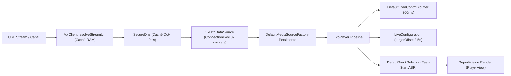

# 🏗️ 02. Arquitectura de Video, Red y Streaming — GarecaTV

## 1. Diagrama de Pipeline de Reproducción (ExoPlayer Media3)

## 2. Parámetros Clave del Motor de Streaming
* **Motor Base**: AndroidX Media3 ExoPlayer (`androidx.media3.exoplayer`).
* **Búfer de Inicio Inmediato**:
  - `bufferForPlaybackMs = 300ms` (Arranque instantáneo de audio/video).
  - `bufferForPlaybackAfterRebufferMs = 1000ms`.
  - `minBufferMs = 15000ms` y `maxBufferMs = 25000ms` (absorción en RAM segura para TV boxes de 1GB).
* **Live Edge Alignment**:
  - `targetOffsetMs = 3500ms` (3.5 segundos detrás del vivo, óptimo para sliding windows HLS de 6-12s).
* **Fast-Start ABR**:
  - `setForceHighestSupportedBitrate(false)`: renderiza el primer fragmento de 300 KB y escala a 1080p en el segundo chunk.

## 3. Zapping Continuo de Canales (`ChannelNavigationManager`)
* En categorías lineales (`📺 Regionales`, `🏆 Deportes`, países), las teclas `◀` y `▶` llaman a `zapToNextChannel()` / `zapToPreviousChannel()`.
* **Reutilización de Pipeline**: No se llama a `player.stop()` destructivo; se transfiere el nuevo `MediaSource` al reproductor existente manteniendo activo el hardware decoder.
